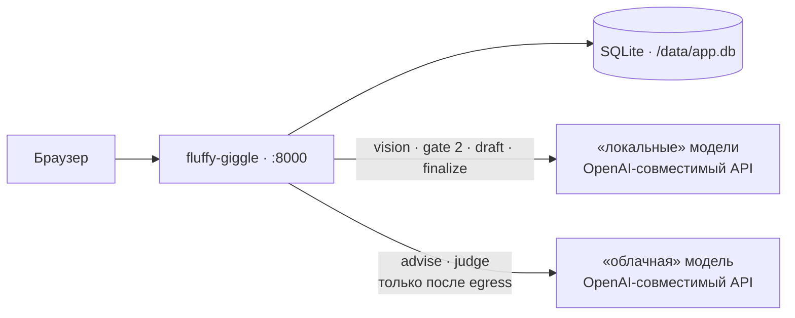
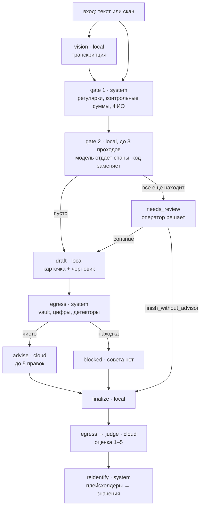
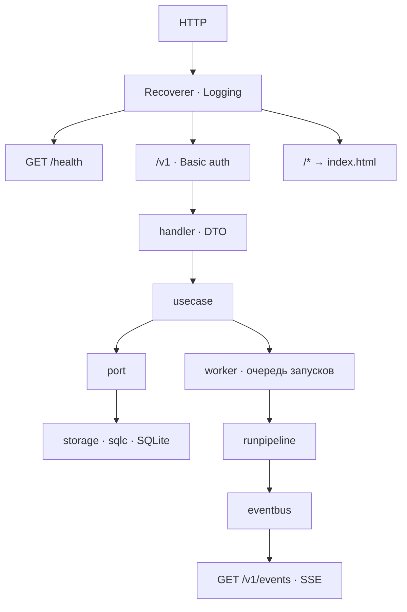

# Карта системы

Что с чем связано. Правила — в `AGENTS.md`, решения — в [adr/](../adr/), требования — в [specs/0001](../specs/0001-pipeline-prototype/spec.md).

## Развёртывание

Один бинарь: Go-сервис со вшитым `web/` и SQLite в одном файле. Образ собирает GitHub Actions и пушит в Yandex Container Registry; деплой вне этого репозитория.

Все три модели — внешние endpoint'ы ([ADR 0002](../adr/0002-logical-boundary.md)). «Локальная» сторона — те, кому можно видеть сырые данные; «облачная» получает только обезличенную карточку и черновик.

## Пайплайн

Режимы adviser: `on`, `off` (совета нет), `placebo` (три общих замечания без обращения к облаку). Судья работает во всех режимах, поэтому бенчмарк сравнивает их на одной шкале. Канарейки фикстуры считаются по тому, что реально ушло в cloud-шаги.

## Путь запроса

`POST /v1/runs` только создаёт запуск; воркеры (`PIPELINE_CONCURRENCY`) исполняют его в фоне и публикуют каждый шаг в шину, которую читает SSE. Страница запуска живёт на этих событиях.

## Границы

| Кто | Что видит |
|---|---|
| `platform` | ничего о прикладном коде |
| `domain` | стандартную библиотеку и себя |
| `usecase` | `domain` |
| `presentation`, `storage`, `llm`, `anonymizer`, `fixture` | `usecase`, `domain`, `platform` |
